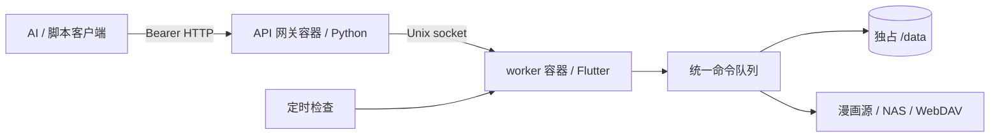

# Docker 与 Headless 服务

此方案继续使用 Flutter Linux 桌面引擎，在容器内启动 Xvfb 虚拟显示、Mesa 软件渲染和会话 D-Bus。宿主机只需 Docker Engine 与 Compose v2，无需安装桌面。它还不是纯 Dart 服务，也不是零图形依赖的运行时。

附带的密钥生成器、验证脚本和客户端示例使用 Python 3；生产服务自身的 Python 运行时已在镜像内。

## 进程和数据边界



- API 网关和 worker 位于不同容器、不同进程。网关只挂载 IPC 卷及 API 密钥文件，不挂载 `/data`，也不直接执行 Flutter 命令。
- worker 持有数据目录锁，统一维护 SQLite、下载队列、源账号、NAS 连接和调度引擎。定时任务与 AI 写入命令经过同一个队列，不会启动另一个调度进程抢占目录。
- 最多并发 4 个查询，慢速 NAS 查询最多占 1 个位置。搜索等交互查询可以越过排队写请求，前台写请求优先于 NAS/自动调度，写请求等待 30 秒后提升优先级避免饿死。导入配置、更新源保持独占屏障。图片下载仍使用原有下载并发设置；完整规则见 [CLI 服务入口](headless_doc.md#统一服务入口)。
- worker 和网关均使用 UID/GID `10001:10001`。默认命名卷由镜像预设权限初始化，避免依赖宿主机 UID。

## 启动

在仓库根目录执行：

```bash
python3 tool/headless_setup.py
docker compose build
docker compose up -d --wait
docker compose ps
```

首次构建需要下载 Flutter 3.47.3、Ubuntu 依赖和原生插件；构建需要联网。worker 使用 Ubuntu 24.04，多阶段镜像仅在构建层保留 SDK 和编译工具。构建支持宿主平台 `linux/amd64` 或 `linux/arm64`，不同架构需要分别验证插件和目标 NAS。

密钥生成器只创建或保留 `.secrets/api-token`，不打印值，也不会覆盖已有密钥。父目录权限为 `0700`，文件为 `0444`，使 Compose 的非 root 文件密钥挂载可读。该目录和所有常见签名密钥已排除在 Git 和 Docker 构建上下文之外。不要把 `.secrets` 目录设为公共共享目录。

默认 API 仅监听宿主机 `127.0.0.1:8080`。可设置 `VENERA_API_PORT` 更换宿主机端口，或设置 `VENERA_API_TOKEN_FILE` 指向其他密钥文件。远程接入需要自行在前端配置 TLS/访问控制；持有 token 的客户端可执行账号已有权限范围内的下载、删除队列及同步命令，请只交给可信调用方。

worker 使用容器默认 UTC 时区。每日、每周及 cron 计划按 worker 本地时区计算。需要北京时间时，在 Compose worker 中增加 `environment: {TZ: Asia/Shanghai}`；运行时镜像提供时区数据库。

## 配置漫画源和 NAS

空数据卷可以查询状态，但没有漫画源、账号或 NAS 连接。将可信源脚本放入配置目录并重启 worker 后，可以使用专用 `/v1/source-auth` 接口完成登录、退出、换号和校验，详见 [Headless 登录流程](headless_auth.md)。API 不接受安装任意源脚本或读取本机凭据文件。NAS 配置仍可从已有 GUI 配置导入。

1. 在 GUI 中配置漫画源、登录及 NAS，然后关闭 GUI，备份数据目录。
2. 对新的容器部署，在第一次正式运行前将所需配置副本放入 worker `/data`。可在 `docker compose create worker` 后用 `docker compose cp /absolute/profile/. worker:/data/` 复制，再用 `docker compose run --rm --no-deps --user 0 --entrypoint chown worker -R 10001:10001 /data` 修正命名卷权限。
3. 检查副本中的 `local_path`、下载队列和本地媒体路径。macOS/Windows 的绝对路径不能直接用于 Linux；容器应使用 `/data/local`，外置漫画目录则另行挂载并配置正确容器路径。不要把未迁移的队列交给调度任务。
4. 启动后通过 `sources list`、`nas list`、`nas test` 检查配置。SMB/SFTP/FTP/WebDAV 需要能从容器网络访问 NAS；容器中的 `localhost` 指向本容器。

也可以将已有 NAS 漫画通过 `nas library`、`nas download` 下载到空的容器本地库。迁移已有本地媒体时应先验证小样本及路径映射；本次未实现跨系统数据目录自动迁移。

使用 bind mount 替换命名数据卷时，需要使目录及漫画文件对 UID 10001 可读写。API 仍只挂载 IPC 卷，不能共享应用数据目录。备份应先停止 worker，避免复制正在写入的数据库；`docker compose down` 保留命名卷，`down --volumes` 会删除数据。

## HTTP 接口

除 `/healthz` 外均需要 `Authorization: Bearer <token>`。只接受 JSON，不启用浏览器 CORS；携带 `Origin` 的请求被拒绝。

| 方法及路径 | 用途 |
|---|---|
| `GET /healthz` | 网关和 worker 连通性，返回 200 或 503，不返回账号数据 |
| `POST /v1/source-auth` | 异步源账号操作；凭据只在内存转发，不进入请求日志 |
| `GET /v1/status` | worker PID、按优先级统计的排队数、运行请求、查询列表、调度进度及队列限制 |
| `POST /v1/commands` | `{"args":["search","source-key","关键词","--page","1"]}`，成功返回 202 和 request ID |
| `GET /v1/requests` | 当前请求和最近 100 条终态记录的摘要，不返回命令参数 |
| `GET /v1/requests/<id>` | 状态、优先级、排队/执行截止时间、`stopRequested`、进度、完整结果及 `exitCode` |
| `POST /v1/requests/<id>/cancel` | 请求体 `{}`，协作取消排队或执行中的请求 |

HTTP 202 只表示请求已持久化接收。轮询状态，直到 `completed`、`failed`、`cancelled` 或 `interrupted`；只有 `completed` 且 `exitCode: 0` 表示该命令成功。`downloads add --enqueue-only` 的命令成功仅表示下载队列已保存，查看其内部 `result.status` 判断是否需要执行下载。

响应外层为 `{"ok":true,"data":...}`。命令最终结果中的 `result` 复用 CLI 协议。鉴权失败返回 401；参数错误 400；找不到请求 404；达到相应优先级的队列容量时返回 429；worker 不可用返回 503。后台排队上限 192，非交互请求合计 224，总排队上限 256，为交互查询保留 32 个名额。单请求体上限 256 KiB，命令最多 64 个字符串、合计 65536 字符；最终结果上限 1 MiB，查询请使用分页。

请求摘要中的 `priority` 为 `interactive`、`normal` 或 `background`，由服务按命令类型设置。`queueDeadlineAt` 是排队截止时间，`timeoutMs` 为执行预算；开始执行后提供 `startedAt`、`executionDeadlineAt`。状态及请求查询、取消 RPC 不经过业务排队。

如果 AI 通过 HTTP 接入，可在 Compose 项目的 `.env` 中打开标签显示过滤，并设置名单：

```dotenv
VENERA_AI_HIDE_TAGS=true
VENERA_AI_HIDDEN_TAGS='["示例标签", "另一个标签"]'
VENERA_AI_HIDDEN_TAG_FRAGMENTS='["示例词段"]'
```

开关默认关闭，两个名单默认均为空。即使已经设置名单，也需要显式启用。关闭时将 `VENERA_AI_HIDE_TAGS` 改为 `false`，可保留名单供以后使用。开关支持 `true/false/1/0`。它是网关的启动配置，HTTP 请求不能修改。

首次使用时运行 `docker compose up -d --no-deps --build api` 更新已部署的 API。之后修改开关或名单，运行 `docker compose up -d --no-deps api` 让 Compose 应用新配置。独立 Python 网关使用方法见 [CLI 文档](headless_doc.md)。

启用后，HTTP 网关从搜索、排行、作品详情和书库结果的 `tags` 字段移除匹配项，保留作品、顺序及分页。匹配忽略大小写、全半角差异及首尾空格。全名名单支持标签文本和 `分组:标签` 写法，兼容详情的分组列表及书库的扁平列表。词段名单在标签文本中查找，命中时隐藏整条标签。简繁体请分别列出。配置适用于该网关的全部客户端，只过滤结构化作品标签字段。标签目录、查询条件、标题和简介仍按原样处理。数据库、直接运行的 CLI 和 App 使用原始数据。

可分别覆盖排队和执行预算，例如 `{"args":["search","source-key","关键词","--queue-timeout","10","--timeout","30"]}`。交互查询默认排队 30 秒，普通写请求 10 分钟，NAS 及自动调度 1 小时；执行默认普通查询 60 秒、NAS 查询/测试 2 分钟、下载/调度 1 小时、NAS 传输 6 小时、WebDAV/源更新 5 分钟。`service serve` 自身仍不设默认寿命。

示例客户端从文件读取密钥，不把它放入命令参数或日志：

```python
import json, pathlib, time, urllib.request

token = pathlib.Path('.secrets/api-token').read_text().strip()
base = 'http://127.0.0.1:8080'

def call(path, body=None):
    request = urllib.request.Request(base + path,
        data=None if body is None else json.dumps(body).encode(),
        headers={'Authorization': 'Bearer ' + token, 'Content-Type': 'application/json'})
    with urllib.request.urlopen(request, timeout=10) as response:
        return json.load(response)['data']

request_id = call('/v1/commands', {'args': ['library', 'list', '--limit', '20']})['id']
while True:
    result = call('/v1/requests/' + request_id)
    if result['state'] not in ('queued', 'running'):
        print(json.dumps(result, ensure_ascii=False))
        break
    time.sleep(0.5)
```

查询、下载、NAS 和调度命令与 [CLI 文档](headless_doc.md) 相同。`help` 返回可用命令结构；服务拒绝 `--data-dir`、`--cache-dir` 和嵌套 `scheduler serve` / `service serve`，防止通过请求改变运行目录或启动第二个服务。

创建定时任务后 worker 每秒检查到期任务，无需另起 cron 或 `scheduler serve`。外部调度器也可以向此 API 提交 `scheduler rundue`。API 请求不是交互式命令行，不经过 shell 执行。

## 持久化、取消与重启

`/data` 包含数据库、源配置、下载队列、作业及 `service_requests.json`。该日志保存未完成排队请求及最近 100 条终态结果，权限 `0600`；网关看不到文件。API 重启不会停止下载或调度。

worker 正常退出先停止接收请求，再协作取消执行中的任务，等待文件写入结束，保留未执行请求。启动后恢复未过期的排队请求；过期请求以 `queue_timeout` / 124 结束并且不会执行。截止时间持久化，停机时间也计入；旧日志用原创建时间和默认预算补算。上次执行中请求标记为 `interrupted`，不会自动重做可能有副作用的命令。传输状态还可通过 `jobs get`、`downloads list`、`scheduler history` 查询。下载队列恢复后需提交 `downloads run`；调度任务按自身计划、启动执行和重试规则运行。

请求取消或执行期限到达时立即标记 `stopRequested`，查询和排行榜源读取在异步等待中也检查取消。分页、详情、节流和 NAS 哈希分块有取消检查点。已经开始的上传文件/清单提交、文件安装或回滚须先安全结束，执行位在收尾完成前继续保留，防止超时后两个写操作重叠。同步执行的源脚本仍不能被 Dart 定时器强制抢占。

自动调度每轮只处理一项任务；NAS 到期任务可推迟，逾期 5 分钟后恢复原到期顺序。Compose 为 worker 提供 120 秒停止宽限期，内部 supervisor 保留 Xvfb/D-Bus 至 worker 结束，90 秒仍未退出时才强制结束。网络特别慢时可同时增加 `VENERA_STOP_TIMEOUT` 和 `stop_grace_period`。

```bash
docker compose logs --tail 100 worker api
docker compose restart api       # 不影响 worker
docker compose stop             # 等待安全停止
```

## 验证

```bash
docker compose build
docker run --rm venera-headless-worker:local --self-test
docker run --rm venera-headless-worker:local --service-self-test
docker run --rm venera-headless-worker:local --auth-self-test
python3 tool/headless_compose_smoke.py
```

前两项使用独立配置和本机 HTTP/WebDAV fixture，测试搜索、真实图片下载、NAS 上传下载、调度、取消恢复及分进程服务。auth-self-test 验证登录、换号、退出、续期、取消回滚、重启和凭据脱敏。Compose 测试创建独立项目、临时密钥和测试卷，检查权限、挂载隔离、健康检查和跨容器重启持久化，结束只删除它创建的测试卷，不使用正式数据。

GitHub Actions 的 `Headless Docker` 工作流执行 amd64 镜像构建及以上四项检查，不推送镜像或发布版本。正式发布前仍需在目标 NAS 架构、Docker 版本、网络和存储权限下验证实际源登录及所用的 NAS 协议，fixture 不能替代这些环境检查。

2026-11-03 本地验证使用 Colima 的 ARM64 Linux 虚拟机（真实 Linux 内核）和 Docker：328 项 Flutter 测试、14 组容器账号/查询流程、9 组容器 CLI、15 组服务和 8 组 Compose 检查均通过。macOS 使用真实 picacg 账号和服务完成 32 项 CLI、13 项 API 检查，包括登录、搜索、日/周/月排行、分类、标签查询、失效 token 恢复、退出后拒绝访问和重新登录。另有 14 组 macOS 模拟流程以及 13 条无窗口/焦点探针。测试账号配置已清理，报告不包含账号密码或 token；Linux 的账号/查询检查使用模拟 API。本次没有运行 amd64 工作流，也没有使用真实 NAS 账号测试远端服务。

容器测试发现并修复了干净构建缺少 Linux 插件注册文件，以及 Release 优化导致只写未读的锁句柄被提前回收的问题。现在在最终退出路径显式释放锁，确保运行期间句柄保持存活；相关生命周期行为参见 [Dart 文档](https://api.dart.dev/dart-ffi/Finalizable-class.html)。

本地导出的 ARM64 镜像包 `Venera-headless-linux-arm64-images.tar.gz` 同时包含 worker 和 API 镜像，导入后可以跳过构建：

```bash
docker load -i Venera-headless-linux-arm64-images.tar.gz
python3 tool/headless_setup.py
docker compose up -d --no-build --wait
```

镜像包仅适用于 ARM64。amd64 设备应在对应平台从 Dockerfile 构建，再执行上述验证。
